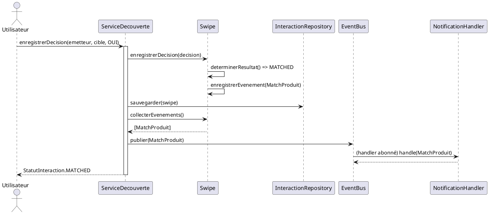

# 🎯 Exercice 2 — Domain Events : identifier et réagir

| Champ | Valeur |
|-------|--------|
| **Difficulté** | 🟡 Intermédiaire |
| **Temps** | ~40 minutes |
| **Niveau cognitif** | Analyser → Appliquer → Créer (Bloom) |
| **Prérequis** | Exercice 1 (archi hexagonale de HexaTP), notions d'agrégat et de publish/subscribe |
| **Type** | Jeu d'exercices (identification + implémentation guidée par diagramme) |

> 💡 **Domain Event** = un fait métier **déjà survenu**, digne d'intérêt pour d'autres parties du
> système. On le nomme **au passé** (`MatchProduit`, pas `ProduireMatch`). Il est **émis par le
> domaine** mais **publié par l'application**, après persistance.

---

## Contexte

On repart de l'agrégat `Swipe` de HexaTP. Aujourd'hui, quand deux participants disent OUI, le statut
passe à `MATCHED`… et **rien d'autre ne se passe**. Or un match devrait déclencher des réactions :
notifier les deux personnes, ouvrir une conversation, mettre à jour des statistiques, etc.

Plutôt que de câbler tout ça en dur dans le service (couplage fort), on va **émettre un événement**
et laisser des *handlers* indépendants y réagir.

Rappel de l'agrégat actuel :

```typescript
export class Swipe {
  private readonly decisions: DecisionSwipe[] = [];
  private statut: StatutInteraction = StatutInteraction.PENDING;

  enregistrerDecision(decision: DecisionSwipe): void { /* ... + determinerResultat() */ }
  determinerResultat(): StatutInteraction { /* passe à MATCHED si 2 OUI distincts */ }
  getStatut(): StatutInteraction { return this.statut; }
}
```

---

## 📦 Matériel fourni — le bus d'événements (à NE PAS écrire)

Le mécanisme de livraison vous est donné. **Lisez-le, ne le réimplémentez pas.**

### Le contrat d'événement vit dans le domaine
```typescript
// src/domain/events/domain-event.ts
/** Tout événement métier porte un nom stable et une date de survenue. */
export interface DomainEvent {
  readonly nom: string;
  readonly dateSurvenue: Date;
}
```

### Le bus vit dans l'infrastructure (détail technique, remplaçable)
```typescript
// src/infrastructure/event-bus.ts
import type { DomainEvent } from '../domain/events/domain-event.js';

export type Handler<E extends DomainEvent> = (event: E) => void | Promise<void>;

/**
 * Bus publish/subscribe en mémoire (synchrone).
 * - souscrire : enregistre un handler pour un nom d'événement.
 * - publier   : appelle tous les handlers abonnés à ce nom.
 */
export class EventBus {
  private readonly handlers = new Map<string, Handler<DomainEvent>[]>();

  souscrire<E extends DomainEvent>(nomEvent: string, handler: Handler<E>): void {
    const liste = this.handlers.get(nomEvent) ?? [];
    liste.push(handler as Handler<DomainEvent>);
    this.handlers.set(nomEvent, liste);
  }

  async publier(event: DomainEvent): Promise<void> {
    const liste = this.handlers.get(event.nom) ?? [];
    for (const handler of liste) {
      await handler(event); // on attend chaque handler (simple et déterministe)
    }
  }
}
```

**À retenir** : le bus ne connaît que l'interface `DomainEvent` du domaine → la dépendance va bien
`infra → domaine`. On publie via le **nom** de l'événement, ce qui découple l'émetteur des réactions.

---

## 🧩 Partie A — Analyser : identifier des domain events (10 min)

En observant le cycle de vie d'une interaction et du quota dans HexaTP, **identifie au moins 2
domain events** pertinents. Pour chacun, remplis :

| Événement (nom au passé) | Déclencheur (quand ?) | Données transportées (payload) |
|--------------------------|------------------------|--------------------------------|
| ? | ? | ? |
| ? | ? | ? |

Contraintes :
- Noms **au passé** et orientés métier (pas technique).
- Le payload doit être **auto-suffisant** : un handler doit pouvoir réagir sans rien aller rechercher.
- Au moins l'un d'eux doit correspondre au diagramme de la Partie B.

---

## 🛠️ Partie B — Appliquer & Créer : implémenter à partir du diagramme (30 min)

Voici le **diagramme de séquence imposé** du cas « un match se produit ». Implémente **exactement ce
flux**.



### Ce que tu dois produire (4 morceaux, commentés)

**B.1 — L'événement `MatchProduit`** (`src/domain/events/match-produit.ts`)
Un objet immuable implémentant `DomainEvent`, portant de quoi notifier les deux participants.

**B.2 — L'agrégat émet et expose ses événements** (`src/domain/swipe.ts`)
- Un tableau privé d'événements.
- Dans `determinerResultat()`, quand on **bascule** vers `MATCHED`, appeler `enregistrerEvenement(new MatchProduit(...))`.
- Une méthode `collecterEvenements(): DomainEvent[]` qui **retourne puis vide** la liste (pattern « collect & clear »).

**B.3 — Le service publie après sauvegarde** (`src/application/service-decouverte.ts`)
Dans `enregistrerDecision`, **après** `sauvegarder`, récupérer les événements de l'agrégat et les
publier sur le bus (reçu par **injection** dans le constructeur).

**B.4 — Un handler + le câblage** (composition root / `demo`)
Un `NotificationHandler` qui réagit à `MatchProduit` (un simple `console.log` suffit), abonné au bus
via `bus.souscrire('MatchProduit', ...)`.

### Contraintes
- Le **domaine n'importe pas** `EventBus` (il ne connaît que l'interface `DomainEvent`).
- On publie **après** la persistance (jamais avant).
- `collecterEvenements()` doit **vider** la liste pour éviter les doublons de publication.
- Conventions du projet : ESM, imports en `.js`, commentaires de processus.

<details>
<summary>💡 Indice 1 (nudge)</summary>

Pose-toi la question « qui *crée* l'événement ? » (le domaine, car c'est lui qui connaît la règle du
match) et « qui le *publie* ? » (le service, car publier est une action d'orchestration/infra). Le
diagramme répond déjà aux deux.
</details>

<details>
<summary>💡 Indice 2 (direction)</summary>

- Dans `determinerResultat()`, mémorise l'ancien statut avant recalcul. Tu n'émets l'événement que
  si tu passes **de non-MATCHED à MATCHED** (sinon tu risques d'émettre plusieurs fois).
- Le service reçoit le bus comme ses autres dépendances : `constructor(..., private readonly bus: EventBus)`.
- `collecterEvenements` : `const evts = [...this.evenements]; this.evenements.length = 0; return evts;`
</details>

<details>
<summary>💡 Indice 3 (near-solution)</summary>

```typescript
// Swipe
private readonly evenements: DomainEvent[] = [];

determinerResultat(): StatutInteraction {
  const avant = this.statut;
  /* ... calcul existant qui met à jour this.statut ... */
  if (avant !== StatutInteraction.MATCHED && this.statut === StatutInteraction.MATCHED) {
    this.evenements.push(new MatchProduit(this.id, this.participantAId, this.participantBId, new Date()));
  }
  return this.statut;
}

// ServiceDecouverte.enregistrerDecision, APRÈS sauvegarder :
for (const evt of interaction.collecterEvenements()) {
  await this.bus.publier(evt);
}
```
</details>

---

## 📋 Barème global (/20)

| Critère | Points |
|---------|--------|
| A — au moins 2 events valides (passé, déclencheur, payload auto-suffisant) | 5 |
| B.1 — événement `MatchProduit` immuable, bon payload | 3 |
| B.2 — émission dans l'agrégat sur la bascule vers MATCHED + collect & clear | 6 |
| B.3 — publication par le service **après** persistance, bus injecté | 4 |
| B.4 — handler abonné + câblage fonctionnel | 2 |
| **Total** | **20** |

> ✅ Correction détaillée dans `correction-exercice-2-domain-events.md`.
